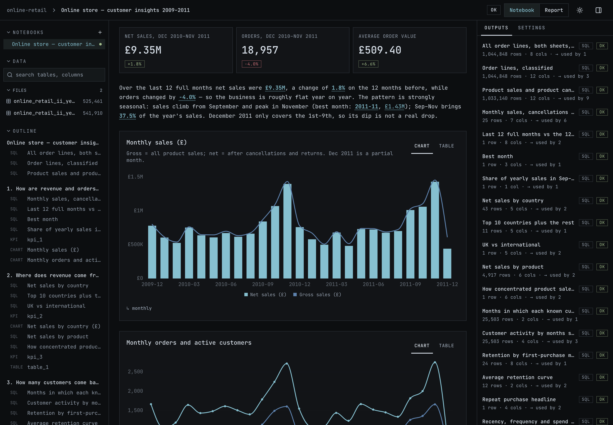
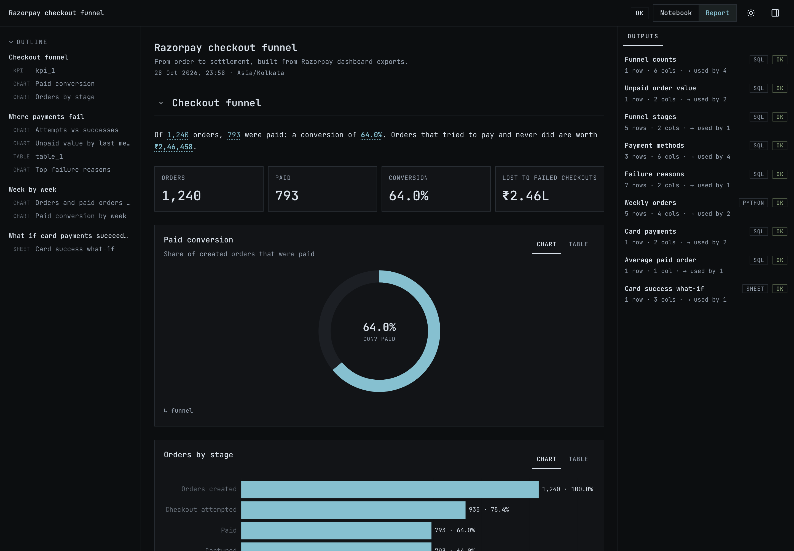
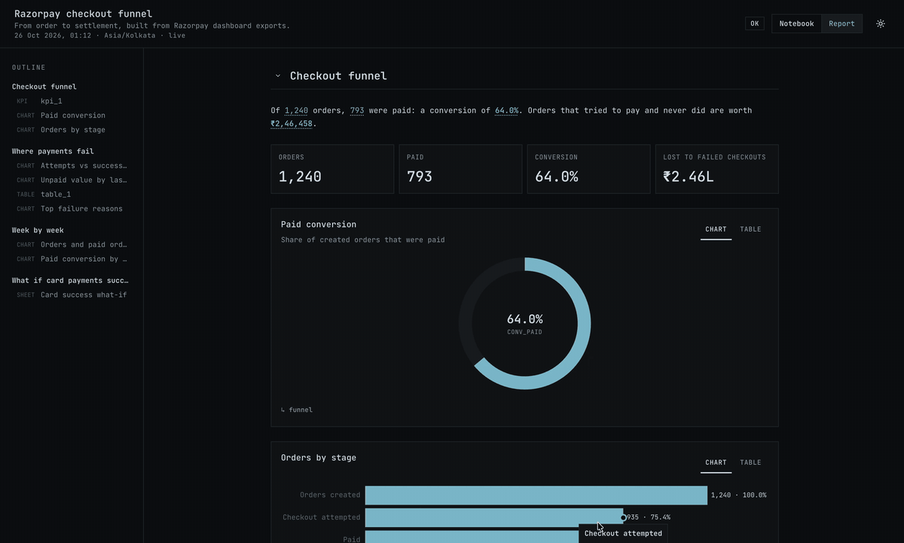

# tracebook

Agent-native data notebook. You ask Claude Code a question about your data files (CSV, Excel, JSON, SQLite, Parquet). It answers inside a notebook of SQL / Python / `.xlsx`-model blocks run on DuckDB. Every number in the answer traces back to the block that computed it, and you can check it, comment on it, and rerun it on new data.

| Notebook view: blocks, queries, results, data browser | Report view: the same notebook as a shareable report |
|---|---|
|  |  |



Full-resolution video: [docs/tracebook_demo.mp4](docs/tracebook_demo.mp4). The screenshots are the example in `examples/razorpay-demo/` (Razorpay checkout funnel from dashboard exports).

## Install
```bash
uv tool install .            # tracebook CLI
tracebook skill install      # agent skill → ~/.claude/skills/tracebook
```

## User flow
1. **Set up a project.** `tracebook init analysis` creates a folder with `data/` (your raw files, never modified), `notebooks/` (markdown notebooks) and `models/` (optional `.xlsx` models).
2. **Bring your data.** Drop exports into `data/` and run `tracebook import data/*`. Import is typed: ambiguous dates or mixed types stop with a `✗` line that names the fix (for example `--types col=date:dmy`) instead of loading wrong values. Known sources (packs, e.g. Razorpay) are recognised and come with their own guide.
3. **Ask Claude Code a question**, e.g. "where do customers drop off in checkout?". With the skill installed, the agent:
   - reads `tracebook schema` and samples the data with `tracebook query`,
   - writes the notebook: SQL / Python / sheet blocks, charts, and a summary sentence whose numbers are references like `{{funnel.paid}}`, not typed-in values,
   - runs `tracebook check` until it reports `✓ 0 error(s)` (it catches broken SQL, missing columns, bad references and type problems, each with a file and line).
4. **Review it.** `tracebook dev` opens the viewer. Click any number to see the query and rows behind it. Switch between the Notebook view (everything) and the Report view (results only). Leave a comment where something looks wrong ("count per user, not per session").
5. **Fix from comments.** On its next turn the agent reads `tracebook comments`, changes the notebook, and resolves each comment with a note saying what changed.
6. **Share.** `tracebook export` writes a self-contained HTML report. `tracebook export --block <id> out.csv` writes one block's result as a CSV.
7. **Rerun on new data.** Import the new export and run `tracebook check`. `tracebook diff` lists which blocks and numbers changed since the previous run.

The agent normally runs all of these commands itself; the full workflow it follows is in `src/tracebook/skill/SKILL.md`.

## Evaluation
The aim is to measure, on benchmark tasks we did not write, whether each layer actually helps:
- **Playbook** (`playbooks/data-analysis`): a generic data-analysis skill (look at the data first, state the definition, check row counts, verify), independent of Tracebook. Should make answers more correct.
- **Tracebook**: the CLI and its skill. Should keep the answer just as correct and also leave a notebook behind that can be checked, reviewed and rerun.

### How it runs
- **Harness:** [Harbor](https://docs.harborframework.com/). Each task is a folder with `instruction.md`, a Docker environment holding the data, a hidden `tests/` folder with the grader and gold answer, and an oracle solution.
- **Setups:** the task is identical for every setup; only the agent's configuration changes (`evals/configs/`).

  | Setup | What the agent gets |
  |---|---|
  | **CC** | plain Claude Code |
  | **CC+P** | Claude Code + the playbook skill |
  | **CC+P+T** | Claude Code + the playbook skill + the tracebook CLI, its skill, and a `CLAUDE.md` asking for a notebook |

- **Rules:** the grader is never changed to make a run pass. Every task is first checked with the oracle (must score 1) and with an agent that does nothing (must score 0). Each setup gets 3 attempts per task. Only one thing changes between runs, and each change is logged with its hypothesis and result.
- **What gets measured:**
  - **A, correctness:** the benchmark's own grader, 0 or 1 per attempt.
  - **B, process** (planned): cost, turns, and whether the final answer came from a notebook block or from a side script.
  - **C, trust** (planned): planted faults caught by `check`, numbers a reviewer can trace, review comments fixed, correct reruns on new data.

### Tasks (dataset `evals/datasets/data-agent`: correct answers; a notebook-quality dataset comes later)
Both come from [Spider2-lite](https://github.com/xlang-ai/Spider2), a public text-to-SQL benchmark, and use the same SQLite database: a website's logs (19 tables, e.g. `activity_log`, `form_log`, `access_log`). The agent writes its answers as CSV files, and Spider2's own comparison grades them against the gold results.

| Task | What it asks | Answer |
|---|---|---|
| `local329` | How many unique sessions visited `/regist/input` and then `/regist/confirm`, in that order? | one count (gold: 1, from `form_log`) |
| `log-web-funnel` | The four funnel questions of the same database in one request, as an analyst would ask them: **Q1** = `local329`; **Q2** sessions per page as landing or exit page; **Q3** the three most common pages right after two consecutive `/detail` visits; **Q4** sessions with the fewest search events before the first `/detail` click or `/complete` (Spider2 `local329`, `local330`, `local331`, `local360`) | four tables, each graded on its own; the task score is the share correct |

### Results (Claude Haiku 4.5, Claude Code 2.1.312, 3 attempts per task and setup)
| Setup | `local329` | Funnel Q1 | Q2 | Q3 | Q4 | Funnel average | Cost (both tasks, 6 attempts) |
|---|---|---|---|---|---|---|---|
| **CC** | 3/3 | 1/3 | 3/3 | 0/3 | 0/3 | 33 % | $0.51 |
| **CC+P** | 2/3 | 2/3 | 0/3 | 0/3 | 0/3 | 17 % | $0.67 |
| **CC+P+T** | 3/3 | 0/3 | 2/3 | 0/3 | 0/3 | 17 % | $0.76 |

- **No setup is clearly better yet.** With 3 attempts, a difference of one attempt is noise.
- **Every CC+P+T attempt built a notebook** (6/6, all passing `tracebook check`, one section per question).
- **Why the funnel fails:**
  - **Q1:** Q2 and Q4 say "using the activity log table", and agents carry that over to Q1, counting `/input → /confirm` in `activity_log` instead of `/regist/...` in `form_log`. In the notebooks the wrong `FROM activity_log` is visible at a glance.
  - **Q3 and Q4:** every attempt read them differently from Spider2's gold (Q3: 33 `/detail` visits counted against 55 in the gold; Q4: sessions with at least one search event returned instead of those with none). Both look under-specified in the benchmark itself.
- **A Tracebook gap found:** two notebooks quoted a number by row position (`{{q2_landing_exit[2].unique_sessions}}`) from a multi-row table, so the sentence named one page but showed another page's count, and `check` passed it. Next: `check` warns on row-indexed references into multi-row blocks.
- **Earlier runs** (old setup, `local329` only): CC 2/3, CC+P 3/3 after its skill description was fixed (2/3 before, when the skill was never loaded), CC+P+T 3/3 but a notebook in only 1/3.

### Running the evals
```bash
evals/adapters/spider2-lite/fetch.sh cafb867313aa local329 local330 local331 local360   # Spider2 files + database (one-time download)
uv run --project evals/adapters/spider2-lite python -m spider2_lite.main --task-ids local329
uv run --project evals/adapters/spider2-lite python -m spider2_lite.main --bundle log-web-funnel
echo 'ANTHROPIC_API_KEY=...' > evals/.env                             # or CLAUDE_CODE_OAUTH_TOKEN (from `claude setup-token`)
evals/run.sh evals/configs/cc.yaml                                    # runs both tasks; also cc-p.yaml, cc-p-t.yaml
evals/run.sh evals/configs/cc.yaml --install-only                     # check setup only, no model calls
harbor view evals/jobs                                                # browse runs and trajectories
```
`evals/run.sh` caches the Linux Claude Code build and tracebook on your machine and mounts them read-only into each trial, so trials install nothing (local Docker only).

## Repository layout
| Path | What |
|---|---|
| `src/tracebook/` | CLI, runtime (import, blocks, `check`), source packs (e.g. Razorpay), agent skill, built viewer |
| `playbooks/` | Claude Code skills with data-analysis know-how, independent of Tracebook (`data-analysis`) |
| `web/` | viewer source (React + Vite); `npm run build` writes `src/tracebook/viewer/` |
| `tests/` | `uv run pytest` |
| `evals/` | Harbor adapter for Spider2-lite, setup configs, runner |
| `examples/razorpay-demo/` | example workspace (`tracebook import data/*.xlsx && tracebook check` rebuilds it) |
| `docs/` | screenshots, demo video |
